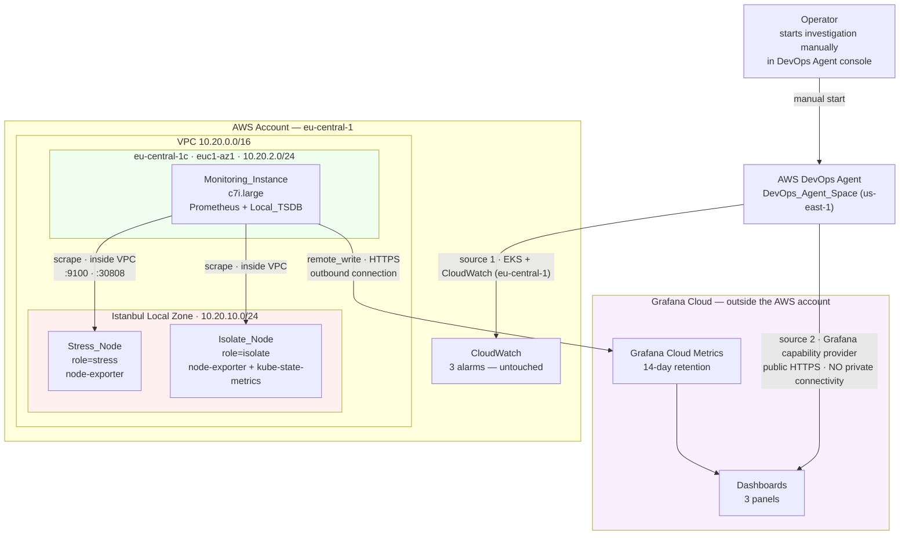
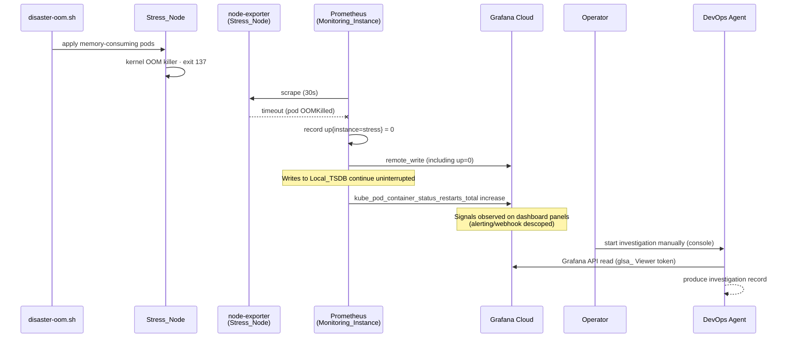

# Design Document

## Overview

This design collects metrics from the `eks-istanbul` cluster outside both the cluster and the Istanbul Local Zone, and stores them outside the AWS account. There are three layers:

1. **In-cluster exporters**: `node-exporter` (on both worker nodes) and `kube-state-metrics`. Thin, stateless, they only serve `/metrics`.
2. **Monitoring_Instance**: a standalone EC2 instance in Frankfurt (`eu-central-1c`). It runs Prometheus, scrapes the exporters from inside the VPC, keeps a local TSDB and forwards data to Grafana Cloud via `remote_write`.
3. **Grafana Cloud**: dashboards, long-term retention and the public HTTPS endpoint that the DevOps Agent reads from.

Core principle of the design: **the observer must not share the fate of the observed.** Because Prometheus runs outside the cluster, it is not affected by the injected disaster scenarios. Because scraping happens from the outside, a target going down (`up = 0`) is **recorded**, and that record is a distinguishing signal for the investigation.

> **Scope change (descoped by operator decision):** Grafana alert rules (CPU_Alert, Memory_Alert, Restart_Alert), the webhook Contact_Point, the Notification_Policy and the Agent_Payload_Template are out of scope. Investigations are started manually from the DevOps Agent console in the DevOps_Agent_Space (us-east-1), and scenario signals are observed on the dashboard panels.

> **Deployability:** the demo must remain fully deployable with `terraform apply` plus the documented scripts (`setup-monitoring.sh`, `provision-monitoring-instance.sh`) and the documented manual Grafana Cloud / AWS Console steps. The dashboard is imported from `k8s/monitoring/grafana-dashboard.json`. README and demo guide are in English. Secrets never appear in any file; placeholders such as `<GRAFANA_CLOUD_USER>`, `<REMOTE_WRITE_PASSWORD>` and `<glsa_TOKEN>` are used instead.

Traceability: Requirements 1-15 map to the corresponding sections of this document. Each section heading lists the matching requirement numbers in parentheses.

## Architecture

### Network and Component Placement



The red area (Local Zone) is the target of the disaster scenarios. The green area (Frankfurt) is the observer and is never touched. Alert rules, the webhook Contact_Point and the Notification_Policy are descoped and have been removed from the diagram. There is one DevOps_Agent_Space, in `us-east-1`, with two sources: EKS + CloudWatch in `eu-central-1` and Grafana Cloud. For supported regions, check the AWS DevOps Agent documentation.

### Data Path During a Disaster



The `up = 0` record is the payoff of this design: an in-cluster collector would die at the same moment and could not produce this record.

## Components and Interfaces

### 1. Monitoring_Instance (Requirements 2, 14)

| Property | Value | Rationale |
|---|---|---|
| Instance type | `c7i.large` (2 vCPU / 4 GiB) | Verified to be offered in `eu-central-1c`; compute-optimized; sufficient for Prometheus + local TSDB |
| Subnet | `subnet-0151c4076afb1def8` | `eu-central-1c`, `euc1-az1`, `10.20.2.0/24`; outside the Local Zone |
| Root disk | 30 GiB `gp3` | More than enough for 24 hours of local retention |
| Public IP | Yes | For the outbound `remote_write` connection; no inbound internet port is open |
| Management | Terraform (`terraform/main.tf`) | Consistent with the repository's existing pattern |

Routing verified: `rtb-0dfe7bf6f11243483` is associated with all three subnets and carries both the `10.20.0.0/16 → local` and `0.0.0.0/0 → igw-021b982d9be11f367` routes. In-VPC access from Monitoring_Subnet to the Local Zone subnet and internet egress are therefore already in place; **no new routing resources are required.**

#### Resources to add to Terraform

```
aws_security_group.monitoring              # Monitoring_Security_Group
aws_security_group_rule.monitoring_ssh_in  # 22/tcp, source var.my_ip
aws_security_group_rule.monitoring_https_out
aws_security_group_rule.cluster_node_exporter_in   # 9100/tcp, source monitoring SG
aws_security_group_rule.cluster_ksm_in             # 30808/tcp, source monitoring SG
aws_iam_role.monitoring                    # ec2:DescribeInstances
aws_iam_instance_profile.monitoring
aws_instance.monitoring
```

New variables: `monitoring_instance_type` (default `c7i.large`), `monitoring_disk_size` (default 30), `monitoring_local_retention` (default `24h`), `ssh_key_name`.

New outputs: Monitoring_Instance private IP, SSH command, SSH tunnel command for the Prometheus UI.

**Left untouched:** the two existing node groups, the four add-ons, the three CloudWatch alarms and the two existing security group rules are not modified.

### 2. Target Discovery: Decision and Rationale (Requirements 2, 3, 14)

Four options were evaluated:

| Option | Assessment |
|---|---|
| `kubernetes_sd_configs` + ServiceAccount token | Requires Kubernetes authentication; moving the token to the host and rotating it adds overhead |
| EKS access entry + `aws-iam-authenticator` | Extra binary on the host and EKS access entry management |
| `static_configs` / `file_sd` | Node IPs change on every scaling event; a manually updated target address conflicts with Requirement 14.1 |
| **`ec2_sd_configs`** | **Selected.** No Kubernetes authentication required; the instance already has an IAM role; nodes arriving with new IPs are discovered automatically |

**Decision:** `ec2_sd_configs` with the filter `tag:eks:cluster-name = eks-istanbul`. Both `node-exporter` and `kube-state-metrics` are found through the same discovery mechanism; the only differences are the target port and the per-job relabeling (see "kube-state-metrics single-target relabel" below). This satisfies the Requirement 14.1 condition that "no manifest file contains a node name or private IP", and no extra setup is needed when node groups are replaced or recreated.

Because `ec2_sd_configs` is used, the Prometheus ServiceAccount and ClusterRole defined in Requirement 3.7 are **not created inside the cluster**; that criterion becomes not applicable and is closed in the task list with this rationale.

### 3. Exporter Reachability (Requirements 3, 11)

| Component | Exposure method | Port | Access restriction |
|---|---|---|---|
| `node-exporter` | DaemonSet + `hostPort` | 9100 | Cluster security group rule sourced only from Monitoring_Security_Group |
| `kube-state-metrics` | `NodePort` Service | 30808 | Same |

Choosing `hostPort` is deliberate: `node-exporter` emits node-level metrics and runs exactly one replica per node, so listening on the node's own address is natural. `kube-state-metrics` is a single-replica Deployment, so it is exposed via `NodePort`.

Both ports are opened **only** by rules sourced from Monitoring_Security_Group. The existing `30000-32767` rule is restricted to the operator IP and is not modified; no rule with source `0.0.0.0/0` is added.

### 4. Prometheus Configuration (Requirements 2, 4)

```yaml
global:
  scrape_interval: 30s
  scrape_timeout: 10s
  external_labels:
    cluster: eks-istanbul

scrape_configs:
  - job_name: node-exporter
    ec2_sd_configs:
      - region: eu-central-1
        port: 9100
        filters:
          - name: tag:eks:cluster-name
            values: [eks-istanbul]
          - name: instance-state-name
            values: [running]
    relabel_configs:
      - source_labels: [__meta_ec2_private_ip]
        target_label: instance
      - source_labels: [__meta_ec2_tag_eks_nodegroup_name]
        regex: ng-istanbul-(.+)
        replacement: $1
        target_label: node_role

  - job_name: kube-state-metrics
    ec2_sd_configs:
      - region: eu-central-1
        port: 30808
        filters:
          - name: tag:eks:cluster-name
            values: [eks-istanbul]
          - name: instance-state-name
            values: [running]
    relabel_configs:
      - source_labels: [__meta_ec2_tag_eks_nodegroup_name]
        regex: ng-istanbul-isolate
        action: keep
      - source_labels: [__meta_ec2_private_ip]
        target_label: instance
      - source_labels: [__meta_ec2_tag_eks_nodegroup_name]
        regex: ng-istanbul-(.+)
        replacement: $1
        target_label: node_role

remote_write:
  - url: ${GRAFANA_CLOUD_REMOTE_WRITE_URL}
    basic_auth:
      username: ${GRAFANA_CLOUD_USER}
      password_file: /etc/prometheus/remote_write_password
    queue_config:
      capacity: 10000
      max_shards: 5
      min_backoff: 30ms
      max_backoff: 5s
    write_relabel_configs:
      - source_labels: [__name__]
        regex: "<METRIC_ALLOWLIST>"
        action: keep
```

Local retention: `--storage.tsdb.retention.time=24h`.

#### kube-state-metrics single-target relabel

- **Problem:** kube-state-metrics runs as one replica pinned to `role=isolate`, behind NodePort 30808 with `externalTrafficPolicy: Cluster`. The NodePort therefore answers on BOTH nodes. EC2 service discovery returns both nodes, so scraping both duplicated every KSM series under two `instance` labels (observed live in task 6, with both targets `up=1`).
- **Fix:** a `keep` relabel on `__meta_ec2_tag_eks_nodegroup_name` matching `ng-istanbul-isolate`, applied in the `kube-state-metrics` job only.
- **`node_role` derivation:** the Kubernetes node label `role=isolate` is NOT an EC2 tag, so `__meta_ec2_tag_role` is empty. `node_role` is therefore derived in both jobs from `__meta_ec2_tag_eks_nodegroup_name` (the tag EKS adds to the EC2 instances) with regex `ng-istanbul-(.+)` and replacement `$1`, giving `stress` / `isolate`.
- **Verified live:** 2 `node-exporter` targets + exactly 1 `kube-state-metrics` target, all `up=1`.
- **Trade-off:** if the Isolate_Node is down, KSM is not scraped. This is acceptable because the KSM pod lives on that node anyway.

#### Metric_Allowlist and Series Budget (Requirement 4)

Filtering is done in `remote_write.write_relabel_configs`, not in `metric_relabel_configs`. Rationale: the local TSDB keeps all metrics (for detailed local investigation) and only the stream to Grafana Cloud is narrowed. This keeps the free-tier limit intact without losing local diagnostic capability.

| Metric family | Usage | Estimated series |
|---|---|---|
| `node_cpu_seconds_total` | CPU panel | 2 nodes × 2 vCPU × 8 modes = 32 |
| `node_memory_MemAvailable_bytes` | Memory panel | 2 |
| `node_memory_MemTotal_bytes` | Memory panel | 2 |
| `kube_pod_container_status_restarts_total` | Restart panel | ~25 |
| `kube_node_spec_unschedulable` | Node isolation signal | 2 |
| `kube_pod_status_phase` | Investigation context | ~100 |
| `up` | Target health, `up=0` record | ~5 |
| `node_load1` | Investigation context | 2 |
| **Total** | | **~170** |

The Series_Budget is defined as 6,000; expected usage is far below it and leaves ample headroom under the 10,000-series free-tier limit. High-cardinality cAdvisor container metrics are **not** in the allowlist.

### 5. Prometheus Lifecycle (Requirements 2, 14)

- `systemd` unit: `prometheus.service`, `enabled`, so it starts automatically when the instance is stopped and started (Requirement 14.13).
- Setup is done by `scripts/provision-monitoring-instance.sh`; `user_data` only installs packages and prepares directories.
- **Secrets are not written to `user_data`.** Because `user_data` is readable from instance metadata, the `remote_write` password is written after setup over SSH to `/etc/prometheus/remote_write_password` with `0600` permissions. The Prometheus configuration references this file via `password_file`.
- The Prometheus web UI listens on `127.0.0.1:9090`; no port is exposed externally. Operator access is via an SSH tunnel (Requirement 2.13).

### 6. In-Cluster Manifests (Requirements 3, 13)

Plain Kubernetes manifests under `k8s/monitoring/`; Helm is not used.

| File | Contents |
|---|---|
| `00-namespace-rbac.yaml` | `monitoring` namespace, `kube-state-metrics` ServiceAccount + ClusterRole (only `get`/`list`/`watch`) + ClusterRoleBinding |
| `10-node-exporter.yaml` | DaemonSet, `hostPort: 9100`, **no** node selector (both nodes) |
| `20-kube-state-metrics.yaml` | Deployment (`replicas: 1`, `role=isolate`), `NodePort` Service (30808) |

Resource allocations:

| Component | CPU request | Memory request | CPU limit | Memory limit |
|---|---|---|---|---|
| `node-exporter` (per node) | 50m | 64Mi | 100m | 128Mi |
| `kube-state-metrics` | 50m | 128Mi | 200m | 256Mi |

Because Prometheus now runs outside the cluster, the in-cluster footprint is noticeably smaller than in earlier designs: a total of 100m CPU / 192Mi memory requested on the Isolate_Node, i.e. less than 6 percent of the node's allocatable resources (1930m / 3215884Ki). The 40 percent budget targeted in the requirements is comfortably met.

### 7. Grafana Cloud Configuration (Requirements 1, 6, 7, 8)

#### Dashboards (Requirement 6)

| Panel | PromQL |
|---|---|
| Node CPU utilization | `100 - (avg by (instance) (rate(node_cpu_seconds_total{mode="idle"}[2m])) * 100)` |
| Node memory utilization | `(1 - (node_memory_MemAvailable_bytes / node_memory_MemTotal_bytes)) * 100` |
| Container restarts | `sum by (pod) (kube_pod_container_status_restarts_total)` |

Visual reference values on the panels (thresholds only, no alerting): CPU 40 percent, memory 55 percent, restarts 0. Scenario signals are observed on these panels.

#### Alert Rules (Requirement 7)

Out of scope (descoped by operator decision). CPU_Alert, Memory_Alert and Restart_Alert are not created. Investigations are started manually from the DevOps Agent console in the DevOps_Agent_Space (us-east-1), and scenario signals are observed on the dashboard panels. The former threshold values (CPU 40 percent, memory 55 percent, restarts 0) remain only as visual panel reference values.

#### `summary` Annotation (Requirements 7.6, 8.5)

Out of scope (descoped by operator decision). Without alert rules and a webhook, no `summary` annotation is delivered to the Agent. Investigations are started manually from the DevOps Agent console in the DevOps_Agent_Space (us-east-1), and scenario signals are observed on the dashboard panels.

#### Webhook Flow (Requirement 8)

Out of scope (descoped by operator decision). The Agent_Payload_Template (`devops-agent-payload`), the webhook Contact_Point and the Notification_Policy are not configured. Investigations are started manually from the DevOps Agent console in the DevOps_Agent_Space (us-east-1), and scenario signals are observed on the dashboard panels.

### 8. DevOps Agent Integration (Requirement 9)

| Step | Where | Note |
|---|---|---|
| Service account with `Viewer` role + `glsa_` token | Grafana Cloud UI | The token is treated as a secret |
| Capability Provider registration | AWS Console | The local AWS CLI has no `devops-agent` command |
| Attach the Capability Provider to the existing DevOps_Agent_Space | AWS Console | The single DevOps_Agent_Space is in `us-east-1`; its other source is EKS + CloudWatch in `eu-central-1`; check the AWS DevOps Agent documentation for currently supported regions |

Because AWS verifies endpoint reachability during registration, the Grafana Cloud stack must be running **before** registration. No private connectivity, certificate upload or SAN matching is needed; Grafana Cloud presents a valid public certificate.

Investigations are started manually from the DevOps Agent console in the DevOps_Agent_Space (us-east-1).

### 9. Scripts (Requirements 12, 13, 14)

The existing repository script pattern is followed exactly: `set -euo pipefail`, numbered steps, ✅/⚠️/❌ markers, `--cluster-name` / `--region` arguments, environment variable defaults, polling loops with timeouts.

| Script | Job |
|---|---|
| `scripts/setup-monitoring.sh` | Verifies the `kubectl` context, applies the `k8s/monitoring/` manifests, waits for **3 pods** (1 kube-state-metrics + 2 node-exporter) to become `Ready` |
| `scripts/provision-monitoring-instance.sh` | Installs Prometheus, places the configuration and the secret password file, enables the `systemd` unit |
| `scripts/cleanup-monitoring.sh` | Removes in-cluster objects; does not touch the CloudWatch layer or AWS/Grafana Cloud resources |

The expected pod count is **3** (it was 4 in earlier designs) because Prometheus has moved out of the cluster.

Cleanup splits into three paths: `kubectl` (in-cluster), `terraform` (Monitoring_Instance), Console/Grafana Cloud UI (stack, Capability Provider and its DevOps_Agent_Space attachment). The webhook is descoped and therefore not part of cleanup.

### 10. Source Attribution Comparison (Requirement 10)

One investigation per scenario is started manually in the DevOps_Agent_Space (`us-east-1`), which has two sources attached: EKS + CloudWatch (`eu-central-1`) and Grafana Cloud. The prompt is identical character for character and contains no hints:

```
We have an active incident in our EKS cluster "eks-istanbul".
Please investigate and report your findings.
```

The comparison table has seven signal rows and two source columns (`Found via CloudWatch/EKS`, `Found via Grafana Cloud`); cell values come from a closed set: `detected`, `not detected`, `could not be investigated`.

Open question, not a claim: because the `kube_node_spec_unschedulable` metric is available on the Grafana side, the DevOps_Agent_Space **may detect** via the Grafana Cloud source the `SchedulingDisabled` condition that the CloudWatch-only baseline missed. Whether this actually happens is the question the demo will answer, and the outcome is recorded in the comparison table.

## Data Models

### Metric Label Schema

| Label | Source | Example |
|---|---|---|
| `cluster` | `external_labels` | `eks-istanbul` |
| `instance` | `__meta_ec2_private_ip` | `10.20.10.76` |
| `node_role` | `__meta_ec2_tag_eks_nodegroup_name` (regex `ng-istanbul-(.+)`, replacement `$1`) | `stress` / `isolate` |
| `pod` | kube-state-metrics | `cpu-stress-1` |

Node identity comes from labels and is never written into any configuration file.

### Webhook Body: Fields That Reach the Agent

Out of scope (descoped by operator decision). No webhook is sent, so no webhook body reaches the Agent. Investigations are started manually from the DevOps Agent console in the DevOps_Agent_Space (us-east-1), and scenario signals are observed on the dashboard panels.

## Error Handling

| Condition | Behavior | Requirement |
|---|---|---|
| `remote_write` temporarily unreachable | Queue holds data, retries with increasing backoff, writes to local TSDB continue uninterrupted | 2.10 |
| `remote_write` queue fills up | Oldest samples are dropped, dropped sample count is exposed as a metric | 2.11 |
| Stress_Node exporter OOMKilled | Only that target is `up=0`, the other is `up=1`, both are forwarded | 5.4 |
| Both nodes unreachable | Prometheus keeps running, all targets recorded as `up=0` | 5.6 |
| Alert query returns no data | Descoped (no alert rules) | 7.13 |
| Webhook request fails | Descoped (no webhook) | 8.12 |
| `glsa_` token invalid | Authentication error is reported, investigation continues without Grafana data | 9.10 |
| Wrong `kubectl` context | No manifest is applied, the fix command is printed, non-zero exit | 12.3 |
| Pod not `Ready` within 300s | Non-ready pods reported by name, objects are not deleted, non-zero exit | 12.5 |
| Object already absent during cleanup | Reported as skipped, remaining steps continue, exit code zero | 14.9 |

## Security

### Network Posture (Requirement 11)

| Resource | Inbound | Outbound |
|---|---|---|
| Monitoring_Security_Group | 22/tcp only from `var.my_ip` (`/32`) | 443/tcp to Grafana Cloud |
| Cluster security group (added) | 9100/tcp and 30808/tcp only from Monitoring_Security_Group | unchanged |
| Cluster security group (existing) | 80/tcp and 30000-32767/tcp only from `var.my_ip`, **not modified** | unchanged |

No inbound rule with source `0.0.0.0/0` or `::/0` is added. The Prometheus web UI listens on `127.0.0.1` and is not exposed to the internet; access is via SSH tunnel.

The Monitoring_Instance has a public IP because `remote_write` requires an outbound connection. This is acceptable: no inbound internet port is open and SSH is restricted to a single `/32` address. A NAT gateway alternative was evaluated and rejected due to its cost (~$32/month); this is a deliberate decision.

### Secrets (Requirement 11)

| Value | Where it lives | In the repository |
|---|---|---|
| `remote_write` password | `/etc/prometheus/remote_write_password`, `0600` | ❌ never |
| `remote_write` user ID | Prometheus configuration | ❌ never |
| `glsa_` service account token | Only in the AWS Console registration | ❌ never |

No secret is written to `user_data` (it is readable from instance metadata). In script output, secrets are replaced with at most 8 masking characters. `.gitignore` already excludes the relevant patterns.

### Data Egress (Requirements 11.10, 11.11)

Only node names, pod names and resource usage values are sent to Grafana Cloud. No logs, environment variable values or credentials are sent. The documentation states that metrics leave the AWS account; in a corporate environment this decision needs separate review.

## Validation Strategy

### Stage 1: In-Cluster and Monitoring_Instance (Requirement 12)

1. Verify in the `terraform plan` output that only new monitoring resources are added and that existing node groups and alarms are unchanged.
2. Run `setup-monitoring.sh`; expect 3 pods to become `Ready`.
3. Through the SSH tunnel, confirm in the Prometheus UI that all targets are `up=1`: 2 `node-exporter` targets + exactly 1 `kube-state-metrics` target.
4. Verify in Grafana Cloud that the three panels show data and that the active series count is below the Series_Budget. (Checking three alert rules in `Normal` state is descoped.)

No DevOps Agent resources are created in this stage.

### Stage 2: Agent Integration (Requirements 12.7, 12.8)

1. Generate the `glsa_` token, register the Capability Provider and attach it to the existing DevOps_Agent_Space.
2. Webhook template, Contact_Point and Notification_Policy configuration: descoped (by operator decision).
3. Run a disaster scenario; verify the signals on the dashboard panels, start the investigation manually from the DevOps Agent console in the DevOps_Agent_Space (us-east-1), and verify that an investigation record is created.

### Scenario Validation

| Scenario | Expected | Upper bound |
|---|---|---|
| `disaster.sh` | CPU panel above the 40 percent reference value (CPU_Alert descoped) | 5 min |
| `disaster.sh` | `kube_node_spec_unschedulable` = 1 (Isolate_Node) | 2 min |
| `disaster-oom.sh` | Memory panel above the 55 percent reference value and restart panel above 0 (Memory_Alert / Restart_Alert descoped) | 5 min |
| `disaster-oom.sh` | Stress_Node `node-exporter` target `up=0` | 1 min |
| After cleanup | Panels return below reference values (rule state `Normal` check descoped) | 10 min |

## Correctness Properties

Invariants that can be verified with property-based testing. Those that do not require live AWS resources are marked with ⚙.

| # | Property | Requirement |
|---|---|---|
| 1 | ⚙ For any set of node/pod names, the number of series produced after applying the Metric_Allowlist does not exceed the Series_Budget | 4.3, 4.5 |
| 2 | ⚙ No metric name outside the Metric_Allowlist passes the `write_relabel_configs` filter | 4.1, 4.4 |
| 3 | Descoped (depends on alert rules): threshold crossing is monotonic; every value series staying above the threshold for the `for` duration produces `Alerting`, none staying below does | 7.2, 7.3, 7.4 |
| 4 | Descoped (depends on alert rules): per-node evaluation; changing one node's metric value does not change the other node's alert state | 7.2, 7.3, 7.10 |
| 5 | Descoped (depends on alert rules/webhook): the `summary` annotation always contains resolved values; no output contains an unrendered template placeholder | 7.6, 8.6 |
| 6 | Descoped (depends on webhook): webhook body schema; every body carries non-empty `title`, `description`, `priority` and incident ID fields | 8.3 |
| 7 | Descoped (depends on webhook): a single state transition of a single alert instance produces exactly one webhook request (unless the repeat interval elapses) | 8.6, 8.9 |
| 8 | `setup-monitoring.sh` is idempotent: a second run does not change pod restart counters and does not create duplicate objects | 12.9 |
| 9 | `cleanup-monitoring.sh` is idempotent: when run with missing objects it exits with code zero | 14.9 |
| 10 | After cleanup, the CloudWatch add-on remains `ACTIVE` and the three alarms remain defined | 14.7 |
| 11 | No manifest or configuration file contains a node name, private IP, EC2 instance ID or ASG name | 14.1 |
| 12 | ⚙ No version-controlled file contains a `glsa_`-prefixed value or the `remote_write` password (including base64) | 11.2 |
| 13 | No security group rule carries a `0.0.0.0/0` or `::/0` source | 11.8 |

Properties 1, 2 and 12 can be tested on configuration files without live infrastructure. Properties 8-11 and 13 require the live stack. Properties 3-7 are descoped together with the alert rules and webhook.

## Risks and Open Points

These are explicit, non-hidden risks:

| Risk | Status | Impact | Mitigation |
|---|---|---|---|
| Monitoring_Subnet → Local Zone scrape latency | **VERIFIED (task 6)** | High latency could cause scrape timeouts | Measured: TCP RTT ~41-45 ms, scrape durations 0.05-0.27 s, well under the 10 s `scrape_timeout`. ICMP is blocked by the security group, so latency was measured over TCP. No change to `scrape_timeout` needed |
| Duplicate kube-state-metrics series | **RESOLVED** | KSM NodePort with `externalTrafficPolicy: Cluster` answered on both nodes; both targets were `up=1` and every KSM series was duplicated | `keep` relabel in `prometheus.yml` limits the KSM job to the `node_role=isolate` node; expected targets are 2 node-exporter + 1 kube-state-metrics, all `up=1` |
| Agent recognition of the `kube_node_spec_unschedulable` metric | **NOT VERIFIED** | The `SchedulingDisabled` gap may not close | Recorded as an open question for the demo to answer; not claimed |
| Incorrectly written Metric_Allowlist | Possible | Silent data loss during the demo | Tested via properties 1 and 2; series count checked in Stage 1 |
| Isolate_Node down | Accepted | KSM is not scraped (single-target relabel) | The KSM pod lives on that node anyway; node-exporter on the Stress_Node is still scraped |
| VPC-level outage | Accepted | Both the cluster and the Monitoring_Instance are affected | The Grafana Cloud copy keeps serving incident data |
| Node group ASG deleted and node group `DEGRADED` | **Observed in this workspace** | In-place scaling is rejected; node groups must be replaced | The design never pins node identity; `ec2_sd_configs` discovers new nodes automatically |
| Monitoring_Instance cost | Accepted | Charges accrue even when worker nodes scale to zero | The instance is stopped outside the demo; `systemd` brings Prometheus up automatically on restart |
| Grafana Cloud 3-user limit | Known | A fourth user cannot be added | Stated in the documentation |

## Design Decisions and Rationale

| Decision | Alternatives | Rationale |
|---|---|---|
| Prometheus outside the cluster, on a standalone EC2 instance | In-cluster stack; in-cluster stateless collector | The observer must not share the fate of the observed; scraping from outside produces the `up=0` record |
| Grafana Cloud (dashboards + retention) | Self-hosted Grafana + VPC Lattice private connectivity; Amazon Managed Grafana | Public HTTPS and a valid certificate → no private connectivity, resource gateway or certificate overhead |
| `ec2_sd_configs` | `kubernetes_sd_configs`; `static_configs`; EKS access entry | No Kubernetes authentication required; adapts automatically when node IPs change |
| KSM job limited to `ng-istanbul-isolate` via `keep` relabel | Scrape both nodes; `externalTrafficPolicy: Local` | NodePort with `externalTrafficPolicy: Cluster` answers on both nodes and duplicated every KSM series; a single target removes duplicates without changing the manifests |
| `node_role` from `__meta_ec2_tag_eks_nodegroup_name` | `__meta_ec2_tag_role` | `role` is a Kubernetes node label, not an EC2 tag, so `__meta_ec2_tag_role` is empty |
| Filtering in `write_relabel_configs` | `metric_relabel_configs` | The local TSDB keeps all metrics (detailed local diagnosis); only the outbound stream is narrowed |
| `node-exporter` via `hostPort` | NodePort Service | One replica per node; listening on the node's own address is natural |
| Public subnet + public IP | Private subnet + NAT gateway | NAT costs ~$32/month; risk is acceptable since no inbound internet port is open |
| 24-hour local retention | Longer; none at all | Long-term retention lives in Grafana Cloud; the local copy ensures continuity during a disaster |
| Manual investigation start from the DevOps Agent console | Grafana alert rules + webhook Contact_Point + Notification_Policy | Descoped by operator decision; scenario signals are observed on the dashboard panels |
