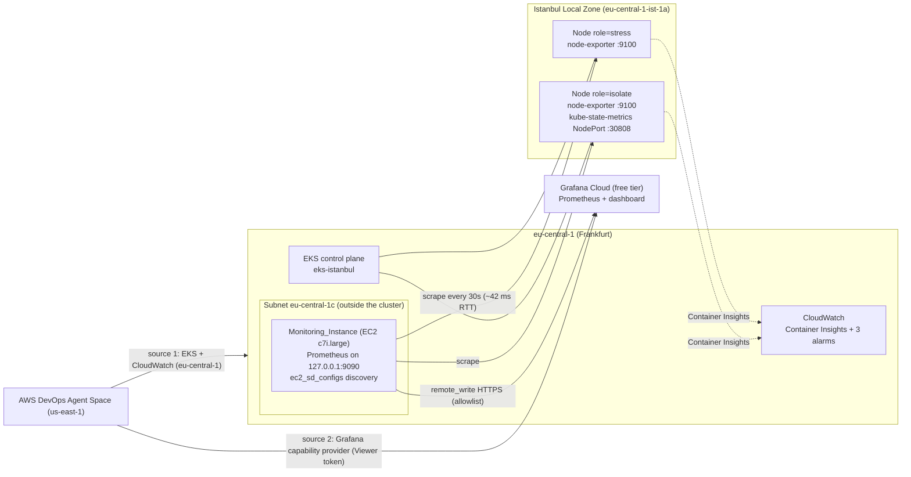

# EKS Istanbul DevOps Agent Demo

A disaster injection and AI-powered incident investigation demo using **Amazon EKS with worker nodes in the Istanbul Local Zone** and **AWS DevOps Agent**.

A single **AWS DevOps Agent Space in us-east-1** investigates the incident. It has two telemetry sources attached:

- **EKS + CloudWatch (eu-central-1)**: the `eks-istanbul` cluster, Container Insights metrics and CloudWatch alarms.
- **Grafana Cloud**: attached through the Grafana capability provider (Viewer service account token). It is fed by an out-of-cluster Prometheus that scrapes the cluster and remote-writes an allowlisted metric set.

The EKS cluster and all infrastructure stay in eu-central-1; only the Agent Space is in us-east-1. One investigation per scenario is run, and each finding is attributed to the source it came from. This shows what each source can and cannot see (for example, node isolation via `kube_node_spec_unschedulable`).

## Architecture



ASCII summary:

```
kubectl (local) ──> EKS control plane (eu-central-1)
                         │
                         ▼
        Worker nodes (Istanbul Local Zone, eu-central-1-ist-1a)
          ├── role=stress   node-exporter :9100
          └── role=isolate  node-exporter :9100 + kube-state-metrics :30808
                ▲                                   │
   scrape (SG-to-SG rules only)                     │ Container Insights
                │                                   ▼
  Monitoring_Instance (EC2, eu-central-1c)      CloudWatch + EKS (eu-central-1)
  Prometheus 127.0.0.1:9090                          ▲
                │ remote_write (HTTPS, allowlist)    │ source 1
                ▼                                    │
  Grafana Cloud ◄──── source 2 ──── AWS DevOps Agent Space (us-east-1)
                (Grafana capability provider, Viewer token)
```

Notes:

- AWS Load Balancers (CLB, ALB, NLB) do not support Local Zone subnets, so the demo uses NodePort with direct node access.
- The Monitoring_Instance lives outside the cluster and outside the Local Zone, so disaster scenarios do not affect it. It can record a target going down (`up = 0`).
- Measured Frankfurt to Istanbul Local Zone latency: ~42 ms RTT; scrape durations 0.05-0.27 s.

## Prerequisites

| Requirement | Notes |
|---|---|
| AWS account | Admin-level access for `terraform apply` |
| Istanbul Local Zone enabled | EC2 console → Settings → Zones → `eu-central-1-ist-1a` → Enable |
| AWS CLI | >= 2.x |
| Terraform | >= 1.0 |
| kubectl | any recent version |
| Existing EC2 key pair | Must exist in eu-central-1 before `terraform apply`; the private key is expected at `~/.ssh/<ssh_key_name>.pem` with mode 600 |
| Grafana Cloud account | Free tier is enough |
| AWS DevOps Agent | Agent Space in us-east-1 (see AWS docs for supported regions); the monitored resources are in eu-central-1 |

Helm is not required. All Kubernetes objects are applied with plain `kubectl`.

Create the key pair if you do not have one:

```bash
aws ec2 create-key-pair --region eu-central-1 --key-name eks-istanbul-monitoring \
  --query KeyMaterial --output text > ~/.ssh/eks-istanbul-monitoring.pem
chmod 600 ~/.ssh/eks-istanbul-monitoring.pem
```

## Deploy

```bash
# 1. Terraform variables
cd terraform
cp terraform.tfvars.example terraform.tfvars
# Edit terraform.tfvars: my_ip ("x.x.x.x/32", from `curl ifconfig.me`) and ssh_key_name

# 2. Infrastructure: VPC, EKS cluster, 2 node groups, add-ons, CloudWatch alarms,
#    Monitoring_Instance + security group + IAM role (~20 minutes)
terraform init
terraform apply
cd ..

# 3. kubectl context
aws eks update-kubeconfig --region eu-central-1 --name eks-istanbul
kubectl get nodes -L role

# 4. CloudWatch path (Container Insights + alarm check)
bash scripts/setup-alarm.sh

# 5. In-cluster exporters (node-exporter DaemonSet + kube-state-metrics NodePort 30808)
bash scripts/setup-monitoring.sh

# 6. Grafana Cloud remote_write credentials (Grafana Cloud portal → your stack →
#    Prometheus → Details). Environment variables only, never files in the repo.
export GRAFANA_CLOUD_REMOTE_WRITE_URL='https://prometheus-prod-XX-prod-XX.grafana.net/api/prom/push'
export GRAFANA_CLOUD_USERNAME='<stack user id>'
export GRAFANA_CLOUD_PASSWORD='<access policy token with metrics:write>'

# 7. Install and configure Prometheus on the Monitoring_Instance (idempotent)
bash scripts/provision-monitoring-instance.sh
```

Expected result of step 7: 3 targets, all `up=1` (2 node-exporter + 1 kube-state-metrics).

8. **Import the dashboard**: Grafana Cloud → Dashboards → New → Import → upload `k8s/monitoring/grafana-dashboard.json` and select your Grafana Cloud Prometheus data source.
9. **Configure the Grafana integration in AWS DevOps Agent (manual, AWS console)**:
   - In Grafana Cloud, create a service account with the **Viewer** role and generate a token (`glsa_...`).
   - In AWS DevOps Agent, add a **Grafana capability provider** with your Grafana URL and that token.
   - Attach the provider to the existing **DevOps Agent Space (us-east-1)**, which already has the EKS cluster and CloudWatch in eu-central-1 as a source (see [docs/demo-guide.md](docs/demo-guide.md)). The agent can then also read dashboards and query Grafana Cloud metrics.
10. **Run a disaster scenario** (see below).
11. **Start one investigation manually** in the DevOps Agent Space with this prompt, then record for each finding which source it came from (CloudWatch/EKS or Grafana Cloud):

    ```
    We have an active incident in our EKS cluster "eks-istanbul".
    Please investigate and report your findings.
    ```

There are no Grafana alert rules and no webhook. Investigations are started manually.

## Disaster Scenarios

Two independent scenarios ship with the demo. Run one at a time.

### Scenario A - CPU saturation + node isolation (`disaster.sh`)

- The `role=isolate` node is cordoned, so it reports `Ready,SchedulingDisabled`.
- 6 stress pods land on the `role=stress` node and saturate its CPU.

Self-terminating: the pods stop after 600 seconds. Trips `eks-istanbul-high-cpu` in about 2-3 minutes (observed ~50% CPU against a 40% threshold). `scripts/disaster-loop.sh` re-injects the scenario every 60 seconds for longer demos.

### Scenario B - Node-level memory exhaustion (`disaster-oom.sh`)

```
memory hog pods (no memory limit)
  -> node memory exhausted
  -> kernel OOM killer terminates containers (exit code 137, OOMKilled)
  -> kubelet restarts them
  -> OOMKilled again, backoff grows
  -> CrashLoopBackOff, climbing RESTARTS count
```

| Choice | Why |
|---|---|
| No `limits.memory` | A cgroup ceiling would kill the container for exceeding its own budget. Without one, allocation continues until the *node* is exhausted. |
| `requests.memory: 64Mi` vs ~900M actual | The kernel scores OOM victims by how far they exceed their request, so the hog pods are killed well before CoreDNS or the CloudWatch agent. |
| `restartPolicy: Always` | Turns a single OOMKill into a visible restart loop with exponential backoff. |

Blast radius is confined to the `role=stress` node; `role=isolate` stays healthy as a control. Not self-terminating: run `cleanup-oom.sh`.

```bash
bash scripts/disaster-oom.sh --pods 5 --bytes 900M
```

Observed on `c7i.large` nodes (2 vCPU, 3.7 GiB):

| Signal | Value |
|---|---|
| Pods OOMKilled | 5/5, exit code 137 |
| Cumulative restarts | 29 and climbing |
| `node_memory_utilization` | ~61% on the affected node |
| `container_memory_failures_total` | 577 |
| System pods | unaffected |
| Node condition | stayed `Ready` |

## CloudWatch Alarms

| Alarm | Metric | Statistic | Threshold | Scenario |
|---|---|---|---|---|
| `{cluster}-high-cpu` | `node_cpu_utilization` | Average | 40% | A |
| `{cluster}-high-memory` | `node_memory_utilization` | Maximum | 55% | B |
| `{cluster}-container-restarts` | `pod_number_of_container_restarts` | Maximum | 0 | B |

Thresholds are configurable through the `memory_threshold` and `restart_threshold` Terraform variables.

### Why the memory alarm uses Maximum, not Average

Alarms are dimensioned on `ClusterName`, which aggregates across every node. During Scenario B the affected node sat at ~61% while the idle node sat at ~39%, putting the cluster **Average** near 50%. `Maximum` tracks the worst node instead. Cluster-wide averages hide single-node failures.

### Why `MemoryPressure` stays False during Scenario B

The kubelet sets `MemoryPressure` from a housekeeping loop that samples every ~10 seconds against `memory.available: 100Mi`. The kernel OOM killer reclaims memory faster than that loop observes the shortfall, so the node condition often never flips. Evidence lives in `container_memory_failures_total` and the restart counts.

## Prometheus Metric Allowlist and Series Budget

The local Prometheus TSDB keeps everything (24h retention). Only the allowlisted families below are forwarded to Grafana Cloud (`write_relabel_configs` in `k8s/monitoring/prometheus.yml`):

| Metric | Used for |
|---|---|
| `node_cpu_seconds_total` | CPU panel |
| `node_memory_MemAvailable_bytes`, `node_memory_MemTotal_bytes` | Memory panel |
| `kube_pod_container_status_restarts_total` | Container restarts panel |
| `kube_node_spec_unschedulable` | Node isolation (SchedulingDisabled) |
| `kube_pod_status_phase` | Investigation context |
| `up` | Target health (`up=0` when a node stops answering) |
| `node_load1` | Investigation context |

Series budget: 6,000 active series against the 10,000 free-tier cap. The demo topology produces ~170-200 series. High-cardinality cAdvisor container metrics are excluded. kube-state-metrics is scraped through the isolate node only, so its series are not duplicated.

Validate the template locally:

```bash
python3 tests/test_prometheus_config.py   # requires PyYAML
```

## Cost Estimate (eu-central-1, on-demand)

| Resource | Cost |
|---|---|
| EKS control plane | ~$0.10/hr (~$73/mo) |
| 2x c7i.large worker nodes (Local Zone) | ~$0.18/hr each |
| Monitoring_Instance (c7i.large, Frankfurt) | ~$0.10/hr |
| EBS volumes (2x 20 GiB + 30 GiB gp3) | ~$6/mo |
| Grafana Cloud free tier | $0 |

Scale node groups to zero and stop the Monitoring_Instance when not in use (`terraform output scale_to_zero`; `aws ec2 stop-instances`). Prometheus restarts automatically when the instance starts again.

## Cleanup

Run in this order:

```bash
bash scripts/cleanup.sh              # after disaster.sh / disaster-loop.sh
bash scripts/cleanup-oom.sh          # after disaster-oom.sh
bash scripts/cleanup-monitoring.sh   # removes the monitoring namespace and RBAC

cd terraform
terraform destroy
```

Then remove the console-only pieces manually: detach the Grafana capability provider from the DevOps Agent Space (us-east-1) and remove the provider registration, the Grafana service account token, and (optionally) the Grafana Cloud stack and access policy token.

## Repository Structure

```
├── terraform/
│   ├── main.tf                     # VPC, EKS, node groups, add-ons, alarms, IAM, SGs, Monitoring_Instance
│   ├── variables.tf                # Input variables
│   ├── outputs.tf                  # Cluster endpoint, kubeconfig, monitoring SSH/tunnel commands
│   └── terraform.tfvars.example    # Copy to terraform.tfvars (gitignored)
├── scripts/
│   ├── setup-alarm.sh              # Container Insights + CloudWatch alarm
│   ├── setup-monitoring.sh         # node-exporter + kube-state-metrics in the cluster
│   ├── provision-monitoring-instance.sh  # Prometheus on the Monitoring_Instance over SSH
│   ├── cleanup-monitoring.sh       # Remove in-cluster exporters
│   ├── disaster.sh / cleanup.sh    # Scenario A
│   ├── disaster-loop.sh            # Scenario A, re-injected every 60s
│   └── disaster-oom.sh / cleanup-oom.sh  # Scenario B
├── k8s/
│   ├── stress-pod.yaml
│   ├── memory-hog-pod.yaml
│   └── monitoring/
│       ├── 00-namespace-rbac.yaml
│       ├── 10-node-exporter.yaml
│       ├── 20-kube-state-metrics.yaml
│       ├── prometheus.yml          # Prometheus config template (placeholders, no secrets)
│       └── grafana-dashboard.json  # Import into Grafana Cloud
├── tests/
│   └── test_prometheus_config.py   # Allowlist / series budget checks
└── docs/
    └── demo-guide.md               # Step-by-step demo guide
```

## Security Notes

- No ingress rule uses `0.0.0.0/0`. SSH to the Monitoring_Instance is allowed from `my_ip` only; exporter ports 9100 and 30808 accept traffic only from the monitoring security group.
- Prometheus binds `127.0.0.1:9090` only. Use an SSH tunnel: `ssh -i ~/.ssh/<key>.pem -L 9090:127.0.0.1:9090 ec2-user@<public-ip>`.
- Secrets are provided only through environment variables. The remote_write password is written to `/etc/prometheus/remote_write_password` (mode 0600) over SSH, never into the repo, Terraform state or user_data.
- `terraform.tfvars`, state files, plans and logs are gitignored.
- Rotate the Grafana Cloud access policy token and the `glsa_` service account token after the demo.

## Key Findings (CloudWatch-only baseline, before Grafana was attached)

Recorded when the DevOps Agent Space had only the EKS + CloudWatch source attached.

| Finding | Detected by Agent |
|---|---|
| High CPU on stress node | ✅ |
| ENI churn (VPC CNI activity) | ✅ |
| CloudWatch threshold history | ✅ |
| No scaling events | ✅ |
| Node isolation (SchedulingDisabled) | ❌ needs Kubernetes object state |

With Grafana Cloud attached as a second source, the per-source results are recorded in the source attribution table in [docs/demo-guide.md](docs/demo-guide.md).

## Known Limitations of the Istanbul Local Zone

- No AWS Load Balancer support (CLB, ALB, NLB)
- No Spot instances
- Limited instance types (c7i, m7i, r7i; no t3)
- Minimum instance size: large

## License

MIT
